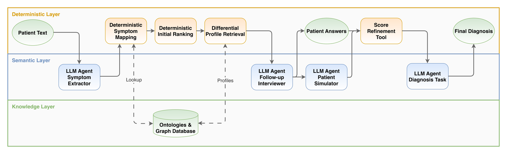
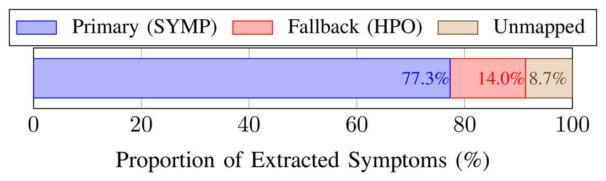
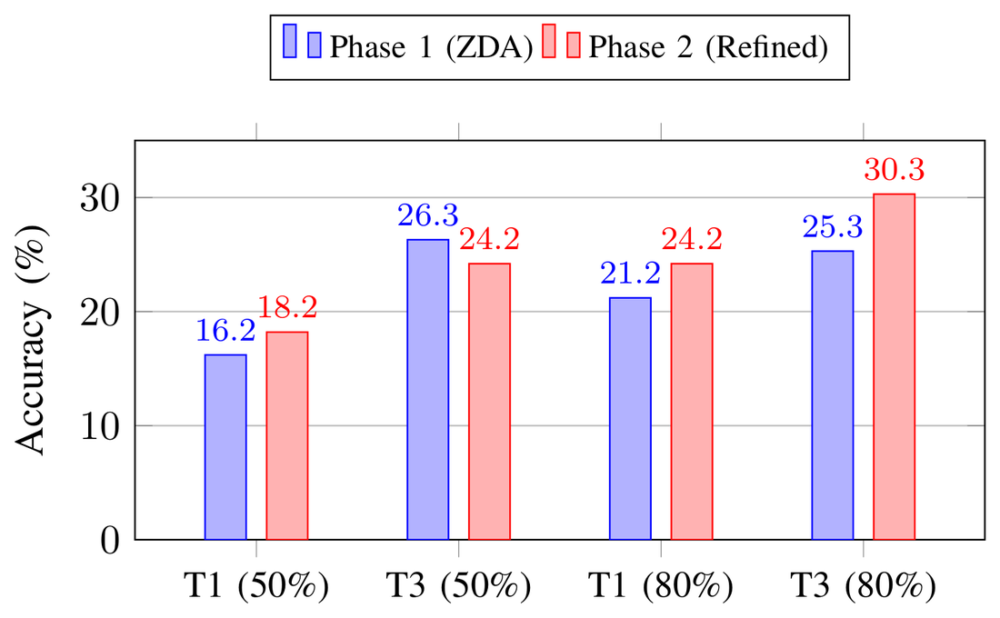
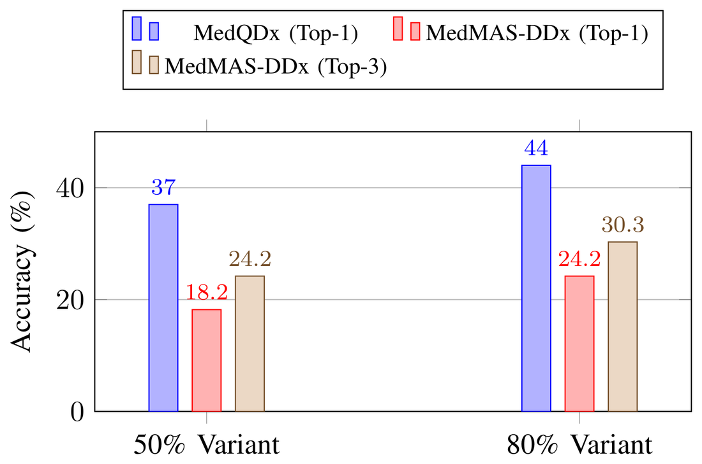

<h1 align="center">MedMAS-DDx</h1>

<p align="center">
  <b>Ontology-guided multi-agent reasoning for explainable differential diagnosis</b>
</p>

<p align="center">
  <a href="https://arxiv.org/abs/2610.36325"></a>
  <a href="pyproject.toml"></a>
  <a href="https://github.com/crewAIInc/crewAI"></a>
  <a href="https://graphdb.ontotext.com/"></a>
  <a href="graphdb/README.md"></a>
</p>

<p align="center">
  
</p>

> **Reference implementation for:**
> R. R. Szomiu, G. Ursu, A. Groza, *Ontology-guided multi-agent reasoning for
> explainable differential diagnosis*, IEEE ICCP 2026.
> Preprint: [arXiv:2610.36325](https://arxiv.org/abs/2610.36325).
> Artificial Intelligence Research Institute (AIRi@UTCN), Department of Computer
> Science, Technical University of Cluj-Napoca.

---

## Abstract

Differential diagnosis is an iterative, information-seeking process, yet most
LLM-based diagnostic systems are evaluated as single-turn classifiers. That
formulation presumes the patient has already disclosed every discriminative
finding, an assumption that fails precisely where diagnosis is hardest: the
sign separating two competing hypotheses is frequently the one absent from the
initial note.

**MedMAS-DDx** is a neuro-symbolic multi-agent framework that separates natural
language understanding from clinical reasoning. Language-model agents are
confined to interpretation and generation; disease–symptom associations are
supplied by expert-curated ontologies held in an RDF triple store and reached
exclusively over SPARQL; and all weighting, ranking, confidence assignment and
control flow execute as deterministic code. Where the initial ranking is
under-determined, the framework quantifies the discriminative power of each
unreported symptom, issues targeted closed-form queries to the patient, and
refines the differential through a bounded multiplicative update that weights
confirmations above denials.

The result is a ranked differential in which every position reduces to an
explicit ontological assertion, and every numeric value is reproducible without
invoking a model.

---

## Design properties

| Property | Mechanism | Consequence |
|---|---|---|
| **Closed-world grounding** | A disease is retrieved only where an explicit `RO_0002452` link to a reported symptom exists. | The system cannot emit a diagnosis absent from the knowledge graph. Hallucinated labels are structurally impossible, not merely discouraged. |
| **Determinism** | Every score, weight, threshold and tie-break is computed in Python. Agents hold no tools and issue no queries. | Identical inputs yield identical rankings. The ordering key `(−score, −matches, name)` removes nondeterminism at ties. |
| **Bounded refinement** | `μ(d) = 1 + α·support − β·conflict`, with `support, conflict ∈ [0,1)`. | `1−β < μ < 1+α`, so follow-up evidence reorders near-neighbours but cannot invert the ranking or rescue a distant candidate. |
| **Abstention safety** | An `unsure` answer, or a disease with no relevant question, leaves `μ(d) = 1`. | Only evidence actually supplied perturbs the ranking. A strictly binary interface would inject information that does not exist. |
| **Traceability** | Scores decompose into per-symptom specificity and discriminative weights. | Each rank reduces to the symptoms and ontology relations that produced it. |

---

## Results

Evaluated on a 99-case benchmark at two disclosure levels, 198 evaluations in
total. Correctness is decided by SapBERT similarity at threshold `0.6`, not by
string equality.

| Metric | Phase 1 (zero-shot) | Phase 2 (after inquiry) |
|---|---|---|
| Top-1 accuracy | 18.7% | **21.2%** |
| Top-3 accuracy | 25.8% | **27.3%** |

Two findings matter more than the aggregate deltas:

- **Ontology coverage.** 91.3% of 1,243 extracted symptoms resolved to an
  ontology concept, with the HPO synonym bridge recovering a substantial share
  that direct SYMP matching missed.
- **Information recovery.** Targeted questioning compensated for a **30% loss
  in initial symptom disclosure**: after inquiry, sparse notes carried the
  diagnostic confidence of substantially richer ones.

<p align="center">
  
</p>

<p align="center">
  
  
</p>

Against an open-vocabulary GPT-4.1 baseline the framework trades raw accuracy
for verifiability: because it refuses to emit a label with no ontology
correspondent, it is penalised where the baseline is not. That constraint is
what makes every prediction auditable.

---

## How it works

The system is organised in three layers.

| Layer | Responsibility |
|---|---|
| **LLM agents** (CrewAI) | Interpretation and generation only: extract symptoms, phrase questions, write the final explanation. |
| **Knowledge base** (GraphDB) | Disease–symptom facts from curated ontologies, reached exclusively over SPARQL. |
| **Deterministic layer** (Python) | Ontology queries, scoring, ranking, confidence, control flow. |

The agents hold no tools of their own. Every SPARQL query is issued by Python,
and the disease profiles an agent needs are pre-fetched and handed to it inside
the task description. Agents never address each other directly.

### Pipeline

```
free-text note
      │
      ▼
 symptom_extractor ────────────► canonical symptom terms          [LLM]
      │
      ▼
 symptom resolution ───────────► SYMP concepts, HPO as fallback   [Python]
      │
      ▼
 disease retrieval ────────────► every disease explicitly linked  [SPARQL]
      │
      ▼
 rank_diagnoses ───────────────► composite score + confidence     [Python]
      │
      ├── one candidate dominates ──► stop, return the differential
      │
      ▼
 disease profiling ────────────► symptom profiles of candidates   [SPARQL]
      │
      ▼
 followup_interviewer ─────────► targeted yes/no questions        [LLM]
      │
      ▼
 answers (user, or simulated patient during evaluation)
      │
      ▼
 RefineScoring ────────────────► discriminative weights, rescore  [Python]
      │
      ▼
 diagnosis_refiner ────────────► narrative explanation only       [LLM]
```

### Agents

Defined in [`src/MedMAS_DDx/config/agents.yaml`](src/MedMAS_DDx/config/agents.yaml).

| Agent | Role |
|---|---|
| `symptom_extractor` | Parses the note into short, ontology-ready symptom terms. Never diagnoses or infers. |
| `followup_interviewer` | Picks the most discriminative unreported symptoms from pre-fetched profiles and writes yes/no questions. Classifies each as patient-reportable or investigation-required. |
| `diagnosis_refiner` | Copies the pre-computed scores verbatim and writes the reasoning narrative. Never calculates anything. |
| `patient_simulator` | **Evaluation only.** Answers a whole batch of questions from a ground-truth profile. Not wired as a CrewAI agent; called directly through `LLM.call()`. |

---

## Repository layout

| Path | Contents |
|---|---|
| [`src/MedMAS_DDx/`](src/MedMAS_DDx/) | The package: crew wiring, orchestration, HTTP server. |
| [`src/MedMAS_DDx/pipeline/`](src/MedMAS_DDx/pipeline/) | Deterministic flows for symptom mapping, disease retrieval and profiling. |
| [`src/MedMAS_DDx/tools/`](src/MedMAS_DDx/tools/) | SPARQL query tools, the two scoring functions, the SapBERT scorer. |
| [`src/MedMAS_DDx/evaluation/`](src/MedMAS_DDx/evaluation/) | Batch evaluation harness, reporting and export. |
| [`Benchmark/`](Benchmark/) | Benchmark case set and the Docker test runner. |
| [`graphdb/`](graphdb/) | Repository configs and the GraphDB init script, which fetches the ontologies. |

---

## Requirements

- Python 3.10–3.13
- Docker and Docker Compose
- A **GraphDB license file** — GraphDB 10+ requires one even for the Free
  edition. Place it at `graphdb/license/graphdb.license`.
  Request one at <https://www.ontotext.com/products/graphdb/#try-graphdb>.
- An LLM endpoint. Two deployments are provided:
  - **external provider** (`docker-compose.external-llm.yml`) — any LiteLLM-compatible model;
  - **self-hosted vLLM on GPU** (`docker-compose.dgx.yml`) — used for the paper's runs.

---

## Quick start

```bash
# 1. put your GraphDB license in place
cp /path/to/graphdb.license graphdb/license/graphdb.license

# 2. configure the model and credentials
cp .env.example .env        # then edit
```

Neither the ontologies nor the benchmark are kept in this repository, and the
two are handled differently.

**The ontologies are fetched for you.** On the first run `graphdb-init`
downloads `doid-international.owl` (33 MB) and `hp.owl` (73 MB) from their
official OBO release URLs, caches them in `graphdb/data/`, and loads them into
two repositories, which takes several minutes. It is idempotent — re-running it
when the repositories already exist exits cleanly.

**The benchmark is not.** It carries no licence, so downloading the two CSV
files is left to you. [`Benchmark/README.md`](Benchmark/README.md) says where
they are and what to rename them to; the Docker build fails without them.

Then pick one of the two deployments below. They differ only in where the
language model runs; both stand up the same knowledge base.

### With an external LLM provider

Reads `.env`. Any LiteLLM-compatible model; nothing runs on a GPU locally.

```bash
docker compose -f docker-compose.external-llm.yml up -d graphdb
docker compose -f docker-compose.external-llm.yml run --rm graphdb-init
docker compose -f docker-compose.external-llm.yml up app
```

The interactive web UI is then served on port 8000 from
`src/MedMAS_DDx/frontend.html`.

### With a locally served model

Reads `.env.dgx`. This is the configuration the paper's runs used: a **vLLM**
container serves `google/medgemma-27b-text-it` behind an OpenAI-compatible API,
and the application reaches it at `OPENAI_API_BASE=http://vllm:8000/v1`. Because
the interface is the same, no application code changes between the two
deployments — only the endpoint does.

The model is served with fp8 weight quantization and an fp8 KV cache, a
65,536-token context window, and 85% of the GPU's memory reserved.

**Additional requirements**

- An NVIDIA GPU and the NVIDIA Container Toolkit.
- A Hugging Face token in `HUGGING_FACE_HUB_TOKEN`. MedGemma is a gated model:
  accept its licence on the Hugging Face model page first, or the download
  fails with a 401.

**Two values in `docker-compose.dgx.yml` are specific to the machine this ran
on and must be changed before the file will work anywhere else:**

| Key | Current value | What it is |
|---|---|---|
| `vllm.deploy...device_ids` | `["2"]` | Pins the server to GPU index 2. |
| `vllm.volumes` | `/mnt/QNAP/urdag/hf_cache` | Host path for the Hugging Face weight cache. |

```bash
docker compose -f docker-compose.dgx.yml up -d graphdb
docker compose -f docker-compose.dgx.yml run --rm graphdb-init
docker compose -f docker-compose.dgx.yml up app
```

The last command also starts vLLM and blocks until its health check passes.
Allow up to ten minutes on a cold start — the weights have to be downloaded and
loaded before the endpoint answers, and the health check is configured with a
600-second grace period for exactly that reason.

One difference worth knowing: in this file the `app` service defaults to
`command: ["test"]`, which runs `batch_runner` over the benchmark rather than
the interactive server, and it publishes no port. This deployment reproduces
the evaluation; it does not serve the web UI. GraphDB's own Workbench is still
published on 7200.

### Without Docker

```bash
uv sync                     # or: pip install -e .
run_crew                    # single interactive run
```

A reachable GraphDB instance with both repositories is still required.

---

## Configuration

Read from the environment; defaults in parentheses.

### Models

Each agent resolves its model in this order: its own override, then
`MEDMAS_DDX_LLM`, then the value in `agents.yaml`.

| Variable | Purpose |
|---|---|
| `SYMPTOM_EXTRACTOR_LLM` | Override for the symptom extractor. |
| `FOLLOWUP_INTERVIEWER_LLM` | Override for the follow-up interviewer. |
| `DIAGNOSIS_REFINER_LLM` | Override for the diagnosis refiner. |
| `PATIENT_LLM` | Model used by the simulated patient during evaluation. |
| `MEDMAS_DDX_LLM` | Fallback for every agent without its own override. |
| `MEDMAS_DDX_LLM_TIMEOUT` | LLM call timeout in seconds (`300`). |
| `MODEL` | Model passed through by the Compose files (`google/gemini-3.1-flash-lite-preview`). |
| `OPENAI_API_BASE` | Endpoint for a self-hosted or proxied OpenAI-compatible provider. |

Provider credentials are read by LiteLLM from the usual variables
(`GOOGLE_API_KEY`, `ANTHROPIC_API_KEY`, `OPENAI_API_KEY`, `DEEPSEEK_API_KEY`,
`HUGGING_FACE_HUB_TOKEN`), depending on which model you point at.

### Knowledge base and scoring

| Variable | Purpose |
|---|---|
| `GRAPHDB_REPOSITORY_URL` | DOID + SYMP endpoint (`http://localhost:7200/repositories/DoidOntologyRepository`). |
| `HP_GRAPHDB_REPOSITORY_URL` | HPO endpoint (`http://localhost:7200/repositories/HpOntologyRepository`). |
| `GRAPHDB_URL` | Base URL used by the init script (`http://graphdb:7200`). |
| `REFINE_SUPPORT_WEIGHT` | α, weight of confirmations (`0.6`). |
| `REFINE_CONFLICT_WEIGHT` | β, weight of denials (`0.2`). |

α > β encodes an asymmetry: a confirmed specific symptom is stronger evidence
than a denied one, because a denial may mean absent, not yet manifest, or
simply unnoticed. See [`tools/README.md`](src/MedMAS_DDx/tools/README.md).

---

## Evaluation

```bash
cd Benchmark
./run_tests.sh --up --pull-model          # first time only
./run_tests.sh -- --variant 100 --limit 5 # smoke test
./run_tests.sh --full                     # all variants, one batch folder
```

Results land in `eval_results/` and `logs/`. See
[`Benchmark/README.md`](Benchmark/README.md) and
[`evaluation/README.md`](src/MedMAS_DDx/evaluation/README.md).

---

## Console scripts

Declared in `pyproject.toml`:

| Command | Entry point |
|---|---|
| `run_crew`, `MedMAS_DDx` | `main:run` — one interactive diagnosis |
| `test` | `main:test` |
| `train` | `main:train` |
| `replay` | `main:replay` |
| `run_with_trigger` | `main:run_with_trigger` |

Inside Docker, `compose_entrypoint.py` dispatches: `normal` starts the uvicorn
server, `test` runs `MedMAS_DDx.evaluation.batch_runner`.

---

## Ontologies

| Ontology | Role | Loaded into | Release |
|---|---|---|---|
| **DOID** (Human Disease Ontology, international edition) | Disease vocabulary and the source of every candidate. Bundles SYMP terms. | `DoidOntologyRepository` | 2026-04-30 |
| **SYMP** (Symptom Ontology) | Symptom vocabulary. Disease–symptom links use `RO_0002452` ("has symptom"). | `DoidOntologyRepository` | with DOID |
| **HPO** (Human Phenotype Ontology) | Synonym bridge for colloquial phrasing. | `HpOntologyRepository` | 2026-02-16 |

A disease enters the differential only if the graph already links it to a
reported symptom. Symptoms that resolve to no concept are logged but excluded
from retrieval, so an unrecognised term cannot distort the ranking.

---

## Third-party data

Nothing here is redistributed. The ontologies are fetched automatically from
their official OBO release URLs, which is what those URLs exist for. The
benchmark is not: it carries no licence, so taking it is left as a deliberate
step for whoever wants to reproduce the evaluation.

| Data | Source | Terms |
|---|---|---|
| DOID + SYMP | [OBO release 2026-04-30](http://purl.obolibrary.org/obo/doid/releases/2026-04-30/translations/doid-international.owl) | [CC0 1.0](https://creativecommons.org/publicdomain/zero/1.0/) |
| HPO | [OBO release 2026-02-16](http://purl.obolibrary.org/obo/hp/releases/2026-02-16/hp.owl) | [HPO's own terms](https://hpo.jax.org/) |
| Q4Dx benchmark cases | [MaiWert/MedQDx](https://github.com/MaiWert/MedQDx) — download by hand | No licence stated — see below |

The benchmark is the work of its authors, and using it means citing them:

> M. Werthaim, M. Kimhi, A. Apartsin and Y. Aperstein, "A benchmark for
> evaluating diagnostic questioning efficiency of LLMs in patient
> conversations," *Scientific Reports*, vol. 16, no. 1, p. 6121, Jan. 2026.
> doi: [10.1038/s41598-026-37022-y](https://doi.org/10.1038/s41598-026-37022-y)

Details and the fetch scripts are in [`graphdb/README.md`](graphdb/README.md)
and [`Benchmark/README.md`](Benchmark/README.md).

---

## Status

Research code accompanying a conference paper. It is a decision-support
prototype evaluated on a synthetic benchmark with a simulated patient. It is
**not** a medical device and is not validated for clinical use.
